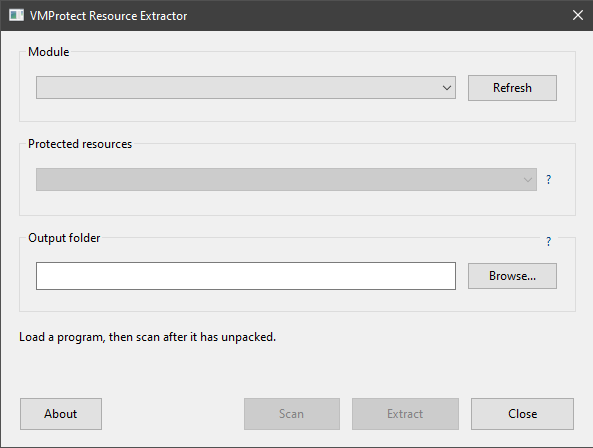
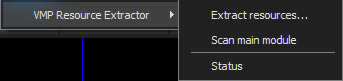

# VMProtect Resource Extractor

I wrote this after tracing VMProtect's Resource Protection across versions 3.3.1 to 3.10.1. It finds the encrypted resource table, recovers its key and extracts the resources from EXE and DLL files.

There is a standalone extractor, a Unicorn-based emulator for packed files, and an x64dbg plugin. None of them needs the original unprotected file or a hardcoded address.



## Download

**[v1.0.0](https://github.com/ivanpotatoes/VMProtect-Resource-Extractor/releases/tag/v1.0.0)**

- [Static extractor](https://github.com/ivanpotatoes/VMProtect-Resource-Extractor/releases/download/v1.0.0/VMProtect-Resource-Extractor-v1.0.0-static-x64.zip)
- [Emulator](https://github.com/ivanpotatoes/VMProtect-Resource-Extractor/releases/download/v1.0.0/VMProtect-Resource-Extractor-v1.0.0-emulation-x64.zip)
- [x64dbg plugin](https://github.com/ivanpotatoes/VMProtect-Resource-Extractor/releases/download/v1.0.0/VMProtect-Resource-Extractor-v1.0.0-x64dbg-x64.zip)

These are Windows x64 builds. No kernel driver or separate Python installation is needed. Checksums, licenses and dependency sources are included in the release.

## Standalone

Start with the static extractor if the resource table and encrypted data are already in the file:

```text
vmp-resource-extractor.exe protected.exe
vmp-resource-extractor.exe protected.dll --output extracted
```

By default, the output goes into `protected.exe.resources` beside the input. Use a new folder for each extraction; existing folders are left alone.

For a packed file, try the emulator:

```text
vmp-resource-emulator.exe protected.exe --output extracted
```

It runs the protected startup code in Unicorn until the resources become available. It does not launch the file as a Windows process. Python, Unicorn and Capstone are bundled in the executable.

The default limits are 240 seconds and five billion instructions. A larger file may need more:

```text
vmp-resource-emulator.exe protected.dll --seconds 600 --instructions 15000000000
```

The emulator handles the startup paths I tested. An unsupported API or exception can still stop it. The three packed test files, timings and implementation details are in [the emulation notes](docs/EMULATION.md).

## x64dbg

1. Copy `VMPResourceExtractor.dp64` into the `plugins` folder beside `x64dbg.exe` and start the debugger.
2. Open **Plugins > VMP Resource Extractor > Extract resources...**



3. Load your program and let it finish unpacking. For a DLL, wait until the host has loaded and initialized it. Select the module in the plugin and click **Scan**.
4. Choose a new output folder and click **Extract**. If more than one table was found, select one first.

**Scan pauses a running target and leaves it paused.** Press F9 when you want to continue. If you resume execution or a DLL is loaded or unloaded, scan again before extracting.

Use **Refresh** to update the module list. **Browse** picks a parent directory and suggests a new output folder. The plugin reads memory without changing your code or breakpoint settings.

The same actions are available from the command bar:

```text
vre_ui
vre_scan
vre_extract "C:\work\extracted"
vre_dump "C:\work\extracted-next"
vre_status
```

`vre_dump` scans and extracts in one command. See [plugin commands and capture limits](docs/PLUGIN.md) for module selection and scripting.

## Output

You get `resource-0001.bin`, `resource-0002.bin`, and so on, plus `manifest.json`. The manifest records each resource's type, name or ID, language, codepage, size and RVA.

The files contain the raw resource bytes. A dialog stays a binary dialog resource, and an icon resource is not automatically converted to an ICO file. The input file is unchanged.

This is an extractor. It does not rebuild `.rsrc` or produce an unpacked executable. Ordinary resources still present in the PE resource directory, such as its manifest, are outside the encrypted tree and are not exported.

## Tested versions

| VMProtect | Static x64 EXE and DLL | Live x64dbg extraction |
| --- | --- | --- |
| 3.3.1 | Verified | Verified |
| 3.4.0 | Verified | Verified |
| 3.5.0 | Verified | Verified |
| 3.6.0 | Verified | Verified |
| 3.8.0 | Verified | Verified |
| 3.9.4 | Verified | Verified |
| 3.10.1 | Verified | Verified |

The static and mapped-image tests recovered **126 resources from 21 files**, with every byte matching the originals. These files had only Resource Protection enabled. They cover menus, dialogs, string tables, custom types, named resources and multiple languages.

Live extraction has also been checked on each version above, including my tests of 3.4.0, 3.5.0, 3.6.0, 3.8.0 and 3.9.4. Packed-file emulation was tested separately on the three files listed in the emulation notes.

Real protected x32 files have not been tested. The emulator and plugin currently support x64 only.

## Build

Install Visual Studio C++ Build Tools and the Windows SDK, then run:

```powershell
.\build.cmd
.\build-plugin.cmd "C:\path\to\pluginsdk"
```

The binaries go into `dist`. [Build instructions](docs/BUILDING.md) cover the emulator, dependencies and tests.

## Research behind the extractor

- [VMProtect 3.3.x–3.10.x Resource Protection analysis](https://ivankozlovsky.com/blog/vmprotect-33x-310x-resource-protection-analysis)

## Contact

Ivan Kozlovsky

[ivankozlovsky.com](https://ivankozlovsky.com) · [contact@ivankozlovsky.com](mailto:contact@ivankozlovsky.com) · [PGP](https://ivankozlovsky.com/pgp.asc)


Project code: [MIT](LICENSE). Bundled dependencies have their own licenses, including GPL-2.0 for Unicorn. See [third-party notices](THIRD-PARTY-NOTICES.md).

## Star history

[](https://www.star-history.com/?repos=ivanpotatoes%2FVMProtect-Resource-Extractor&type=date&legend=top-left)
