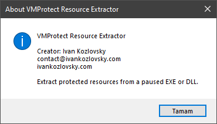

<div align="center">

# VMProtect Resource Extractor

**Extract protected resources from EXE and DLL files**

Static extraction, packed-file emulation and a live x64dbg plugin.

  [](https://github.com/ivanpotatoes/VMProtect-Resource-Extractor/releases/latest)

[**Download**](#download) · [Standalone](#standalone) · [x64dbg plugin](#x64dbg-plugin) · [Tested versions](#tested-versions) · [Research](#research-behind-the-extractor)

<br>


</div>

<br>

I wrote this after tracing VMProtect's Resource Protection across versions 3.3.1 to 3.10.1. It locates the encrypted resource table, recovers its key and writes out the resources. You do not need the original unprotected file or a hardcoded address.

## Download

Choose the tool that fits the file you have. All three are **Windows x64 builds**; no kernel driver or separate Python installation is required.

| Tool | Use it when… | v1.0.0 |
| :--- | :--- | :--- |
| **Static extractor** | The resource table and encrypted data are already present in the file | [Download ZIP](https://github.com/ivanpotatoes/VMProtect-Resource-Extractor/releases/download/v1.0.0/VMProtect-Resource-Extractor-v1.0.0-static-x64.zip) |
| **Emulator** | Startup code needs to unpack the resources first | [Download ZIP](https://github.com/ivanpotatoes/VMProtect-Resource-Extractor/releases/download/v1.0.0/VMProtect-Resource-Extractor-v1.0.0-emulation-x64.zip) |
| **x64dbg plugin** | The program is already loaded under the debugger | [Download ZIP](https://github.com/ivanpotatoes/VMProtect-Resource-Extractor/releases/download/v1.0.0/VMProtect-Resource-Extractor-v1.0.0-x64dbg-x64.zip) |

[Release notes, checksums and dependency sources](https://github.com/ivanpotatoes/VMProtect-Resource-Extractor/releases/tag/v1.0.0)

## Standalone

### Static extraction

```text
vmp-resource-extractor.exe protected.exe
vmp-resource-extractor.exe protected.dll --output extracted
```

The default output is `protected.exe.resources` beside the input. Use a new output folder for each extraction; existing folders are left alone.

### Packed files

```text
vmp-resource-emulator.exe protected.exe --output extracted
```

The emulator runs the protected startup code in **Unicorn** until the resources become available. It does not launch the file as a Windows process. Python, Unicorn and Capstone are bundled in the executable.

<details>
<summary><strong>Emulation limits and larger files</strong></summary>

The default limits are **240 seconds** and **five billion instructions**. Increase them when needed:

```text
vmp-resource-emulator.exe protected.dll --seconds 600 --instructions 15000000000
```

An unsupported API or exception can still stop emulation. [The emulation notes](docs/EMULATION.md) list the three packed test files, timings and implementation details.

</details>

## x64dbg plugin

1. Copy `VMPResourceExtractor.dp64` into the `plugins` folder beside `x64dbg.exe`, then start the debugger.
2. Load the program and let it finish unpacking. For a DLL, wait until its host has loaded and initialized it.
3. Open **Plugins → VMP Resource Extractor → Extract resources…** Select the module and click **Scan**.
4. Choose a new output folder and click **Extract**. If several tables were found, select one first.

<p align="center">
  
</p>

> **Scan pauses a running target and leaves it paused.** Press F9 to continue. Scan again after resuming execution or loading/unloading a DLL.

**Refresh** updates the module list. **Browse** picks a parent directory and suggests a new output folder. The plugin reads memory without changing your code or breakpoint settings.

<details>
<summary><strong>Command-bar usage</strong></summary>

```text
vre_ui
vre_scan
vre_extract "C:\work\extracted"
vre_dump "C:\work\extracted-next"
vre_status
```

`vre_dump` scans and extracts in one command. See [plugin commands and capture limits](docs/PLUGIN.md) for module selection, scripting and table selection.

</details>

## What you get

```text
extracted/
├── manifest.json
├── resource-0001.bin
├── resource-0002.bin
└── …
```

`manifest.json` records each resource's **type, name or ID, language, codepage, size and RVA**. The `.bin` files contain the raw resource bytes: a dialog remains a binary dialog resource, and an icon is not automatically converted to an ICO file.

The input file stays unchanged. This tool extracts the encrypted resource tree; it does not rebuild `.rsrc` or produce an unpacked executable. Ordinary PE resources outside that tree, such as an unencrypted manifest, are not exported.

## Tested versions

| VMProtect | Static x64 EXE / DLL | Live x64dbg extraction |
| :--- | :---: | :---: |
| 3.3.1 | Verified | Verified |
| 3.4.0 | Verified | Verified |
| 3.5.0 | Verified | Verified |
| 3.6.0 | Verified | Verified |
| 3.8.0 | Verified | Verified |
| 3.9.4 | Verified | Verified |
| 3.10.1 | Verified | Verified |

Static and mapped-image tests recovered **126 resources from 21 files**, byte-for-byte identical to the originals. Live extraction was checked on every version above.

Real protected x32 files have not been tested. The emulator and plugin currently support x64 only.

<details>
<summary><strong>Test scope</strong></summary>

The 21 files had only Resource Protection enabled. They cover menus, dialogs, string tables, custom types, named resources and multiple languages.

Packed-file emulation was tested separately on the three files documented in [the emulation notes](docs/EMULATION.md). Those tests do not establish support for every packing configuration.

</details>

## Build from source

<details>
<summary><strong>Requirements and build commands</strong></summary>

Install Visual Studio C++ Build Tools and the Windows SDK, then run:

```powershell
.\build.cmd
.\build-plugin.cmd "C:\path\to\pluginsdk"
```

The binaries go into `dist`. [Build instructions](docs/BUILDING.md) cover the emulator, dependencies and tests.

</details>

[Report a bug](https://github.com/ivanpotatoes/VMProtect-Resource-Extractor/issues) with the extraction mode, VMProtect version, protection options and error output.

## Research behind the extractor

- [VMProtect 3.3.x–3.10.x Resource Protection analysis](https://ivankozlovsky.com/blog/vmprotect-33x-310x-resource-protection-analysis)

---

**Ivan Kozlovsky** · [Website](https://ivankozlovsky.com) · [Email](mailto:contact@ivankozlovsky.com) · [PGP](https://ivankozlovsky.com/pgp.asc)

Project code: [MIT](LICENSE). Bundled dependencies retain their own licenses, including GPL-2.0 for Unicorn. See [third-party notices](THIRD-PARTY-NOTICES.md).

<details>
<summary>About window</summary>



</details>

## Star history

[](https://www.star-history.com/?repos=ivanpotatoes%2FVMProtect-Resource-Extractor&type=date&legend=top-left)
